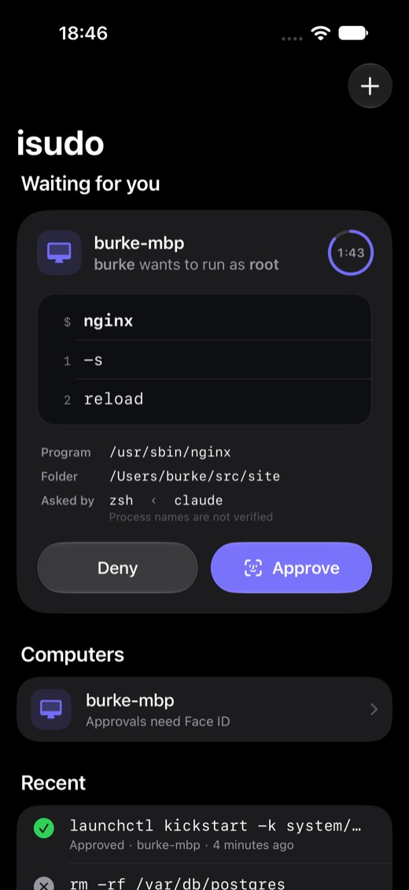
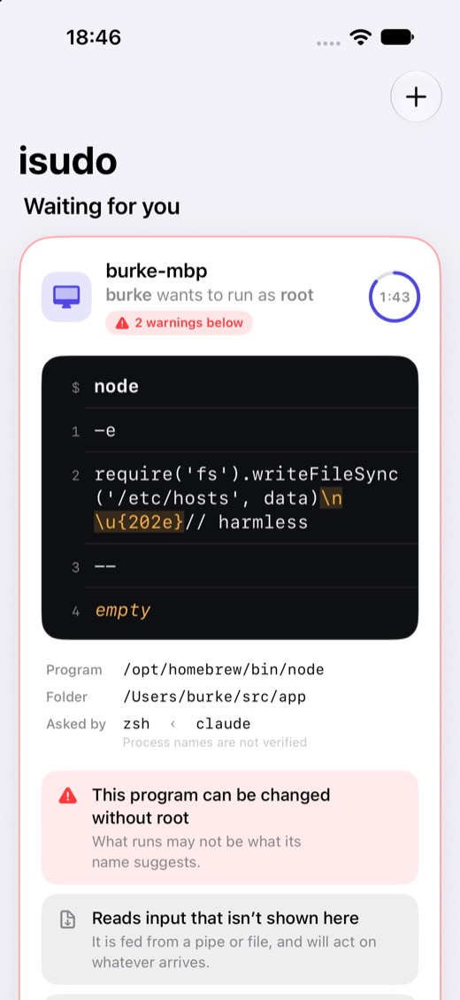
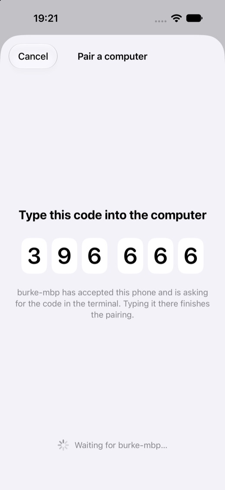
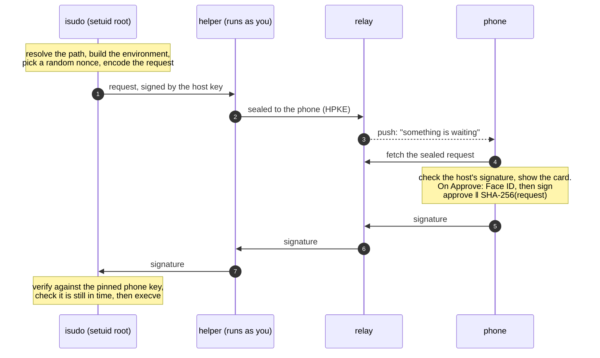

<p align="center">
  
</p>

<h1 align="center">isudo</h1>

<p align="center">
  <b><code>sudo</code>, except every command waits for you to approve it on your phone.</b>
</p>

<p align="center">
  <a href="https://github.com/burke/isudo/actions/workflows/ci.yml"></a>
  <a href="LICENSE"></a>
</p>

An AI agent (or a script, or you) runs `isudo` where it would have run
`sudo`. Your phone shows exactly what would run. It runs as root only if you
approve it with Face ID, and only that command, once.

```console
$ isudo launchctl kickstart -k system/com.openssh.sshd
isudo: waiting for approval on Burke's iPhone (up to 2m00s; Ctrl-C to cancel)
```

<p align="center">
  
  &nbsp;
  
  &nbsp;
  
</p>

> [!WARNING]
> **Experimental.** isudo works end to end on macOS and Linux with an
> iPhone, and it has been tested unusually hard for its size (see [How it is
> checked](#how-it-is-checked)). It is also new, it installs a setuid-root
> program, and it has not had a professional audit. Read [What it does not
> do](#what-it-does-not-do) before you trust it with a machine you care
> about.

## Why

An agent that needs root usually gets one of three things: your password,
passwordless `sudo`, or you at the keyboard typing the password for it. The
first two hand over everything. The third proves you were present, not that
you read what ran.

isudo makes the question specific. Each request is one command, with its
arguments, environment and working directory. You answer it on a device the
agent cannot touch, and your answer is a signature that covers that request
and nothing else. If you say no, you can say why, and the agent reads your
reason.

## How it works



The nonce exists only in the memory of the waiting `isudo` process. A
signature over a request containing it is worth nothing to any other
process, and that one either runs the command or exits. So there is no
replay to defend against, no clock to synchronise, no session to steal, and
no state between runs.

Two things have to be right. Everything between them is allowed to lie:

| | Trusted for | If compromised |
|---|---|---|
| `isudo` and the pairing file | deciding, then executing | game over (it is root) |
| The phone and its Secure Enclave key | showing the request truthfully, signing | game over (it is the approver) |
| The helper | nothing; it runs as the caller | approvals stop arriving |
| The relay | nothing; it sees only ciphertext | approvals stop arriving |
| The network, Apple's push service | nothing | approvals stop arriving |

No TLS, HTTP or JSON code ever runs as root: the helper does the networking
as an ordinary user and hands back a signature that `isudo` checks itself.

### What the phone shows

- The resolved program, every argument on its own line, the working
  directory, and who asked. Nothing is truncated: a long command scrolls,
  and Approve stays disabled until you reach the end.
- Control characters and invisible ones are escaped and tinted, so a
  right-to-left override cannot rearrange what you read.
- Callouts for anything that weakens what the arguments tell you: a program
  that someone other than root could replace, input arriving on a pipe, and
  environment variables that inject code (`LD_PRELOAD`, `NODE_OPTIONS`,
  `BASH_ENV`...).
- A countdown. When the computer stops waiting, the card retires itself.

### Pairing

Run once, as root, at the machine. The computer shows a QR code; the phone
answers; the computer signs for exactly the keys it received; only then does
the phone show six digits, which you type into the terminal.

That ordering matters. If someone else saw the QR code and answered first,
or the relay swapped keys on the way, your phone shows an error instead of a
code, so there is nothing to be tricked into typing. (The first design
showed the code straight away. The protocol model in `formal/` found the
hole, proves the fix, and still reproduces the attack on the old version.)

## Getting started

You need a Mac or Linux machine, an iPhone with Face ID or Touch ID, and
somewhere to run the relay that both can reach over HTTPS.

### 1. Build and install

```sh
nix develop            # or bring your own cargo and cargo-nextest
make build
sudo make install
```

This installs under `/usr/local` on Linux and `/opt/isudo` on macOS (add
`/opt/isudo/bin` to your `PATH`). The difference is deliberate: every
directory from the programs up to `/` must belong to root, and on many Macs
`/usr/local/bin` belongs to you, which would let anything running as you
swap `isudo-admin` before you next run it with `sudo`. `isudo-admin check`
verifies the installation, and pairing refuses to start if it fails.

On NixOS, use the flake's module instead; `make install` would put the
programs where NixOS does not look, and the store cannot hold a setuid file:

```nix
# flake.nix: inputs.isudo.url = "github:burke/isudo";
imports = [ isudo.nixosModules.default ];
programs.isudo.enable = true;          # setuid wrapper in /run/wrappers/bin
services.isudo-relay.enable = true;    # on 127.0.0.1:8787; options for APNs and a registration token
```

That build searches `/run/wrappers/bin:/run/current-system/sw/bin` for bare
command names, and `isudo-admin check` looks for the setuid copy in
`/run/wrappers/bin`. Then pair as in step 4.

### 2. Run the relay

The relay is one small program. It needs no privilege and stores nothing
readable. On the machine that will host it:

```sh
make relay-service          # macOS: as yourself.  Linux: sudo make relay-service
```

That installs it as a launchd agent or a systemd unit, writes a settings
file, and starts it on `127.0.0.1:8787`. It speaks plain HTTP and expects
TLS in front of it. Two easy ways to provide that:

```sh
tailscale serve --bg 8787       # private to your tailnet, real certificate
# or any reverse proxy or tunnel that terminates TLS
```

Out of the box the relay sends no push notifications, and the app shows
requests only while it is open. To be notified, create an APNs key in your
Apple developer account and fill in the four `ISUDO_APNS_*` lines in the
settings file (`contrib/relay.conf.example` documents them).

### 3. Put the app on your phone

There is no App Store build; you build it yourself with Xcode.

```sh
cd ios
cp Local.xcconfig.example Local.xcconfig     # your team id and a bundle id you own
nix shell nixpkgs#xcodegen -c xcodegen generate
open Isudo.xcodeproj                          # run it on your phone
```

More in [ios/README.md](ios/README.md).

### 4. Pair

```sh
sudo /opt/isudo/bin/isudo-admin pair --relay https://your-relay.example
```

Scan the QR code with the app, wait for six digits, type them in. Keep
ordinary `sudo` as your way back in if you lose the phone.

### 5. Use it

```sh
isudo id
```

Approve on the phone, and you should see `uid=0(root)`.

## Using it

```sh
isudo command [arguments...]
isudo DEBUG=1 command                 # set a variable (shown on the phone)
isudo --preserve-env=HTTPS_PROXY cmd  # pass one of yours (shown on the phone)
```

It behaves like `sudo` with `env_reset`:

- **Environment.** The command gets a fresh one (`PATH`, `HOME`, `USER`,
  `SUDO_USER`...), plus your `TERM`, locale and `TZ`. Nothing else crosses
  over unless you name it, and the phone's signature covers the whole
  environment, not only your part of it.
- **Finding commands.** A bare name is looked up in a fixed list of system
  directories, never your `PATH`, and never in a directory that someone
  other than root can write to. To run something from such a place
  (Homebrew, a project directory), give its path; the phone then says the
  program can be changed without root.
- **Privacy.** Paths are resolved with your own permissions, so `isudo`
  tells you nothing about files you could not have examined yourself.
- **Timing.** An approval is acted on only within the window the phone
  showed.
- **Exit status.** The command's own; 1 if denied or unanswered; 126 or 127
  if the command could not be run or found.

```sh
sudo isudo-admin status    # which phone is paired
isudo-admin check          # can anything installed be replaced without root?
sudo isudo-admin unpair
```

### For AI agents

`isudo --skill` prints instructions for an agent, in the skill format:
when to use isudo, how to phrase a request so a person reading it cold on a
phone can approve it, what each exit status means, and that a denial's
reason is an instruction from the user. Save it wherever your agent looks
for skills:

```sh
mkdir -p ~/.claude/skills/isudo && isudo --skill > ~/.claude/skills/isudo/SKILL.md
```

## What it does not do

- **It shows you the command, not its consequences.** Approving
  `isudo ./deploy.sh` approves whatever is in that file when it runs. The
  phone tells you when that is the situation; reading the card is still
  your job.
- **It does not help if there is another way to root.** If the same user
  can `sudo` without a password, is in the `docker` group, or can edit your
  shell startup files to capture your sudo password, close those first.
- **It inherits what sudo inherits.** Resource limits, scheduling priority
  and the terminal pass through to the command. Signal dispositions, timers,
  open files, the umask and the environment do not.
- **It does not work inside sandboxes that forbid gaining privilege**
  (`no_new_privs`, most container and agent sandboxes). `isudo` says so
  rather than failing mysteriously.
- **You are part of the system.** A request approved without being read is
  an approved request.

The exact guarantees, and what counts as a vulnerability, are in
[SECURITY.md](SECURITY.md).

## How it is checked

| Check | What it would catch |
|---|---|
| **Clippy at its strictest** (`make lint`) | Panics, unchecked casts and arithmetic, unexplained `unsafe`. All `unsafe` is in two files of the setuid binary, one system call per block, each with its justification. |
| **Types** | The path from "what would run" to `execve` is a chain of types, each constructible only from the one before. Running without an approval of exactly this request does not compile. |
| **Unit and property tests** (`make test`) | Logic errors. The request codec is tested for round-trips and for two byte strings ever decoding to the same request. The Swift code is tested against vectors generated by the Rust code. |
| **Deterministic simulator** (`make sim`) | The real host, relay and phone logic in one process, under a seeded schedule with an attacker who replays, relabels, tampers and forges. A failure prints its seed. Four safety checks were broken on purpose to confirm it notices. |
| **Protocol model** (`make formal`) | Flaws in the protocol itself. A ProVerif model against an attacker who runs the relay and sees every QR code proves seven properties. |
| **Real setuid root** (`make test-linux`) | The privileged path for real, in a Linux container: full root identity after approval, hostile environment and descriptors, wrong pinned key, timeouts, sandboxes. |

It has also had one independent adversarial review of the setuid code. That
found no route to root without the phone's signature, and six defects (a
caller-owned directory on the search path, no bound on the time between
approval and execution, path lookups that ran as root, and others) that are
now fixed and covered by tests. That is not the same as an audit.

## Questions

**Why not Touch ID for sudo?** That proves you were at the machine. It does
not show you the command on a display the agent cannot influence, and it
does not bind your approval to one command.

**Does the relay see my commands?** No. Requests are encrypted to your
phone's key before they leave your machine; the relay stores ciphertext for
a couple of minutes. It learns timing and sizes.

**What if I lose my phone?** Use ordinary `sudo` to run `isudo-admin
unpair`, then pair the new one. isudo never replaces `sudo`; it sits beside
it.

**Why is it setuid instead of a daemon?** So that it works like `sudo`, with
the caller's terminal, working directory and standard streams, and nothing
running in between. The price is that it must neutralise everything it
inherits from its caller, which is what most of `crates/isudo` is.

**Can I approve for the next ten minutes?** No, deliberately. An approval
covers one request.

**Android?** Not yet. `crates/phone` is the reference for what a phone must
check and sign, and `testdata/vectors.json` is what an implementation is
tested against.

## Development

```sh
make check        # clippy at its strictest, then every test
make sim          # deterministic simulation, many seeds
make formal       # ProVerif: the protocol's properties, proved symbolically
make test-linux   # real setuid root in a container, attacked
```

The whole flow can be exercised on one machine with no root and no phone. A
development build gains no privilege and refuses to run as root, and
`isudo-devphone` is a phone for the terminal:

```sh
cargo build --workspace
cargo build -p isudo --features dev-unprivileged     # target/debug/isudo
target/debug/isudo-relay &
target/debug/isudo-admin pair --relay http://127.0.0.1:8787 --config ./pairing.conf
target/debug/isudo-devphone pair 'isudo://pair?...'  # the link isudo-admin printed
target/debug/isudo-devphone watch
ISUDO_DEV_CONFIG=./pairing.conf ISUDO_DEV_HELPER=target/debug/isudo-helper \
  target/debug/isudo echo hello
```

| Path | What it is |
|---|---|
| `crates/isudo` | The setuid binary: system calls around the decisions in `core`. |
| `crates/core` | The decisions, as pure functions and typestates: what would run, was it approved, which phone gets pinned. No `unsafe`, no I/O. |
| `crates/proto` | Wire formats and the exact bytes each signature covers. |
| `crates/helper` | The unprivileged courier between `isudo` and the relay. |
| `crates/relay-core`, `crates/relay` | The relay as a pure state machine, and its HTTP and push shell. |
| `crates/phone` | What a phone must check and sign; the reference for the iOS app. |
| `crates/admin` | Pairing, unpairing and the installation check. |
| `crates/devphone` | A phone for the terminal, for testing. Not for real use. |
| `crates/sim` | The deterministic simulator and the pairing attack tests. |
| `ios/` | `IsudoKit` (the phone logic in Swift) and the SwiftUI app. |
| `formal/` | The ProVerif model, and the first pairing design it shows to be broken. |
| `tests/setuid` | The real setuid-root test that runs in a Linux container. |
| `contrib/` | Service definitions for the relay. |

## Licence

MIT. See [LICENSE](LICENSE).
